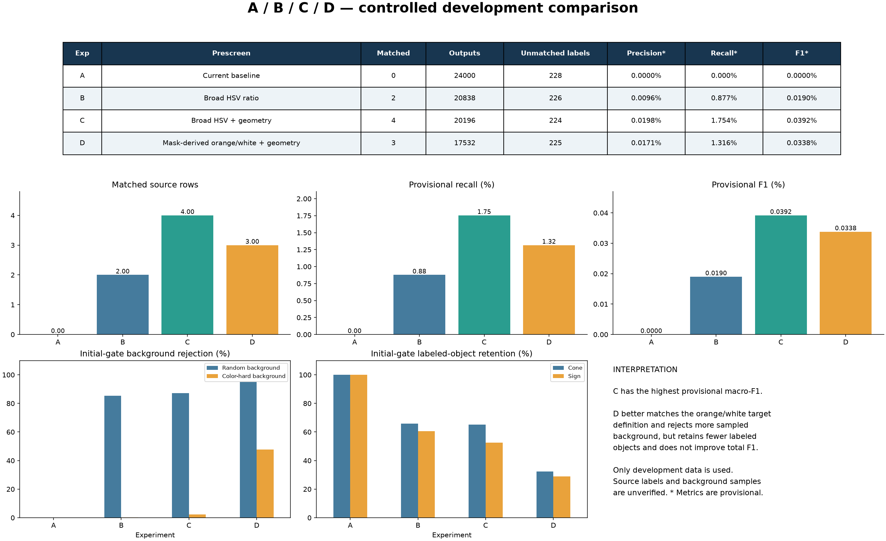

# ROI experiments A / B / C / D

## Start with the image report



Open [all 120 same-scene comparisons](results/index.html). Each image shows **source labels + A + B + C + D**, in that order. Cyan = supplied labels; green = class-matched one-to-one prediction; red = unmatched prediction; orange dashed = unmatched supplied label. Every retained output is drawn; no additional display cap is used.

## What each experiment means

| Experiment | Initial filter | Geometry filter |
|---|---|---|
| A | Existing current baseline; no background rejection | None |
| B | Original broad HSV color ratio | None |
| C | Original broad HSV color ratio | Cone/sign height-to-width ranges |
| D | Latest reference-mask-derived orange/white rules | Same geometry as C |

A/B/C retain their original definitions. **D is the latest orange/white-plus-geometry configuration**, previously stored as C in the later run.

All four share the same candidate windows, frozen grayscale Variance references and class thresholds, ranking, NMS and output limits. This isolates the effect of the initial filters. RGB is used for HSV; grayscale population variance is used afterward.

## Numerical results: whole scenes

These are provisional class-matched IoU >= 0.5 results against the original, uncorrected annotation rows.

| Exp | Matched | Unmatched predictions | Unmatched labels | Precision | Recall | F1 |
|---|---:|---:|---:|---:|---:|---:|
| A | 0 | 24000 | 228 | 0.0000% | 0.000% | 0.0000% |
| B | 2 | 20836 | 226 | 0.0096% | 0.877% | 0.0190% |
| C | 4 | 20192 | 224 | 0.0198% | 1.754% | 0.0392% |
| D | 3 | 17529 | 225 | 0.0171% | 1.316% | 0.0338% |

### Cone and sign separately

| Exp | Class | Matched | Unmatched predictions | Unmatched labels | Precision | Recall | F1 |
|---|---|---:|---:|---:|---:|---:|---:|
| A | cone | 0 | 12000 | 152 | 0.0000% | 0.000% | 0.0000% |
| A | sign | 0 | 12000 | 76 | 0.0000% | 0.000% | 0.0000% |
| B | cone | 1 | 9321 | 151 | 0.0107% | 0.658% | 0.0211% |
| B | sign | 1 | 11515 | 75 | 0.0087% | 1.316% | 0.0173% |
| C | cone | 3 | 8731 | 149 | 0.0343% | 1.974% | 0.0675% |
| C | sign | 1 | 11461 | 75 | 0.0087% | 1.316% | 0.0173% |
| D | cone | 2 | 7599 | 150 | 0.0263% | 1.316% | 0.0516% |
| D | sign | 1 | 9930 | 75 | 0.0101% | 1.316% | 0.0200% |

## Initial-filter behavior: rejection versus retention

These statistics describe the prescreen alone, before the unchanged Variance gate. Background rejection uses union acceptance across both classes. Object retention tests the supplied object class. The same 1,920 background candidate ROIs and 228 supplied object ROIs are regenerated for all four methods.

| Exp | Random background rejected | Hard-color background rejected | Cone ROIs retained | Sign ROIs retained |
|---|---:|---:|---:|---:|
| A | 0.00% | 0.00% | 100.00% | 100.00% |
| B | 85.35% | 0.21% | 65.79% | 60.53% |
| C | 87.08% | 2.29% | 65.13% | 52.63% |
| D | 95.00% | 47.71% | 32.24% | 28.95% |

## Analysis: what the evidence supports

### A: the current classifier has no background rejection

A retains every sampled background candidate and produces 24,000 outputs with no source-label matches. Its grayscale class margin compares cone with sign, not object with background. A road, wall or building region can therefore be assigned to one of the two classes. The result identifies a structural limitation: intensity-based cone/sign discrimination alone is not a foreground detector.

### B: color removes many easy backgrounds but struggles with similar colors

B rejects about 85.35% of the randomly sampled background candidates, but only 0.21% of the deliberately color-hard candidates. Thus the loose HSV rule is useful for rejecting many ordinary regions, yet it provides almost no protection against orange/yellow distractors. B matches two source rows, which is a small development gain over A rather than evidence of a usable detector.

The broad old hue ranges intentionally permitted yellow-orange, and the sign range also admitted yellow. Therefore some accepted regions satisfy the numeric rule without matching the intended orange construction-object definition.

### C: geometry improves this comparison, with a retention cost

Compared with B, C increases matched source rows from two to four and has the highest provisional macro-F1 among these fixed configurations. Cone matching improves from one to three; sign matching remains one. The geometry filter changes which candidates survive ranking/NMS, so final outputs need not be subsets of the B outputs.

However, sign prescreen retention falls from 60.53% to 52.63%. The unchanged candidate bank contains only square and 2:1-tall windows; C keeps tall windows for cone and square windows for sign. This is a restrictive shape approximation and can reject a genuine target whose visible shape or annotation box differs. C is only the best score on this small, noisy development comparison, not an established universal winner.

### D: removing yellow fits the intended target, but the current rules are stricter

D excludes yellow from positive orange/white evidence and separates the classes: cone requires orange and white; sign requires orange only. This better matches the requested color definition and rejects more sampled backgrounds: random-background rejection rises from C's 87.08% to D's 95.00%, and hard-color rejection rises from 2.29% to 47.71%.

**Removing yellow is consistent with the target definition, but the current rule is stricter.** In particular, requiring cone white coverage can reject cones with very little visible white, white stripes darkened by lighting, or solid-orange construction cones. The full-ROI denominator also dilutes orange/white fractions when a candidate contains more background. Conversely, orange and white pixels inside the same ROI need not belong to the same object; a wall and sky can provide both colors without forming a cone. These gates do not perform object segmentation.

The tradeoff is visible in the source-object ROI retention: cone falls from 65.13% in C to 32.24% in D, and sign from 52.63% to 28.95%. Scene matches fall from four to three; provisional total F1 also decreases. Therefore D is better at rejecting these sampled backgrounds, but **does not improve overall detection in this run**.

This is not proof that white alone caused the decline. C-to-D changes hue limits, saturation/value floors, coverage thresholds and the cone-white requirement together. A controlled white-threshold ablation would be required to isolate that effect. No such sweep is included in these four results.

### Annotation uncertainty limits every conclusion

Source annotations are uncorrected model outputs. Duplicate rows can inflate unmatched-label counts; missing labels can make a real target appear to be an unmatched prediction; inaccurate box boundaries and wrong classes can cause IoU/class mismatches. Source sign crops also include at least one stop-sign-like example, which may conflict with the orange temporary-construction-sign reference definition. These are review issues, not automatically corrected labels.

Consequently, red boxes are not confirmed false positives and orange boxes are not confirmed missed real objects. All reported precision/recall/F1 values are provisional. Four versus three matches is weak evidence when labels are uncertain. The most useful current conclusion is the observed background-rejection/target-retention tradeoff, not a claim that one method is ready for deployment.

## Exact rules and shared settings

### B/C broad HSV rules

- Cone: hue 5–55 degrees, saturation >=0.25, value >=0.15; compatible pixels >=2% of ROI.
- Sign: hue 5–70 degrees, saturation >=0.20, value >=0.15; compatible pixels >=3% of ROI.
- Hue is PIL HSV H * 360/256; saturation and value are divided by 255.

### D separate orange/white rules

- Both orange hue ranges: 10–40 degrees.
- Cone orange: S>=0.20, V>=0.20, orange coverage >=2.9%.
- Cone white: S<=0.15, V>=0.65, white coverage >=1.0%; orange+white coverage >=5.8%. All three coverage conditions must pass.
- Sign orange: S>=0.25, V>=0.20, orange coverage >=4.8%. No white or combined-coverage condition.
- Yellow H 45–80 degrees with S>=0.10 and V>=0.15 is excluded from both orange and white evidence.
- All coverage denominators are the entire ROI. White alone never passes. An ROI can contain yellow background, but yellow provides no positive evidence.

D's orange/white distributions and coverage thresholds were derived from the original 183 cone / 36 sign reference masks only, using source-balanced object distributions and fixed extra-background allowances. Hue was bounded by an explicit orange anchor, not automatically allowed to learn yellow as orange. The 1% cone-white minimum is the user-requested adjustable condition, not a universal property learned for all cones. See `D_RULES` in `run_experiments.py` to change these controls for a new development experiment; changing them redefines D and requires rerunning the report.

### Geometry and common classifier

- Geometry in C/D only: cone H/W 1.2–4.0; sign H/W 0.5–1.8.
- Candidates: widths 8,16,24,32,48,64 pixels; height/width 1 or 2; half strides, edge-aligned final windows.
- Frozen Variance references: cone 1708.3979316032287; sign 952.3059516320549.
- Class margin: distance to other reference minus distance to own reference. Thresholds: cone +682.2053792730977; sign -682.2053792730977.
- Rank accepted candidates by own-class reference distance, with original index as tie-break; keep top 1,000 before NMS.
- NMS IoU 0.3; maximum 100 outputs per class. Matching: class-specific, one-to-one IoU >=0.5.

## Data use and ROI sampling

Only `Test Dataset/validation` is evaluated: 120 images, 228 valid original annotation rows and one invalid row. Original labels and images are unchanged. Neither NYC test nor final-test images under `Downloads/datasets` are read. These results are development comparisons, not a final benchmark.

The ROI set is deterministic (seed 42): one random crop for each of 12 window geometries per image (1,440 total), plus four color-hard crops per image (480 total). Sampling excludes every supplied positive-area box expanded by 1.25x. Hard samples are always selected by the original broad HSV score, including for D; the set is not reselected to favor new rules. Missing labels may still contaminate background candidates, and the deliberately hard sampling is not representative of scene prevalence.

## Minimal folder and reproduction

Only the actual generation code, this README and image-report outputs are retained. Old notebooks, caches, configs, manifests, prediction dumps, review helpers and experiment backups have been removed. Numerical results are embedded in this README and the summary image. Original datasets and Intensity main code are preserved.

```text
ROI/
  generate_rois.py       # shared ROI generation and optional crop export
  run_experiments.py     # frozen A/B/C/D inference + image report + README
  README.md
  results/
    summary.png
    index.html
    images/             # all 120 five-panel comparison images
```

Dependencies: numpy, pandas, pillow, matplotlib. From the project root:

```sh
python ROI/run_experiments.py
```

To regenerate actual RGB ROI crops when needed (not stored in the clean default package):

```sh
python ROI/generate_rois.py --output ROI/roi_images
```

Both commands default to the parent project directory and use the validation split only. ROI export creates 1,920 background-candidate and 228 source-label crops; all labels remain unverified. No extra cached result files are required to reproduce the report.
